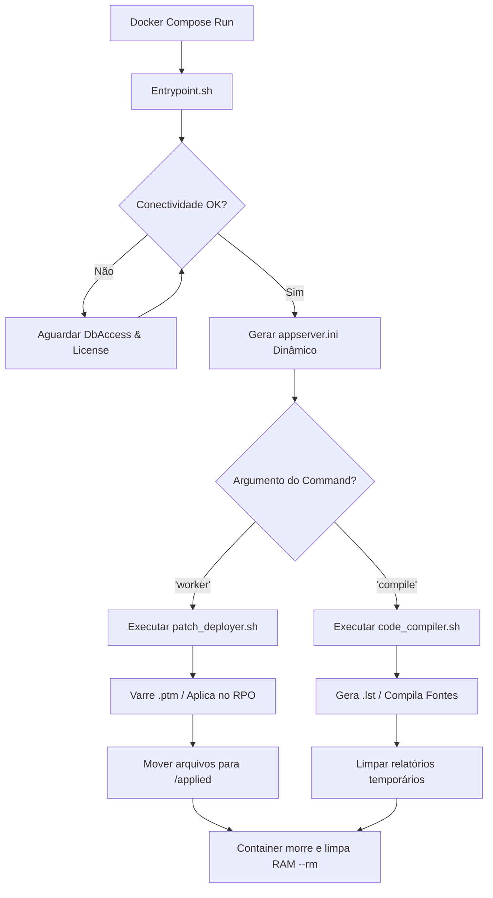

# TOTVS Protheus AppServer - Automated DevOps Worker 🚀

Imagem Docker especialista desenvolvida para atuar de forma efêmera (Job CLI) executando esteiras automatizadas de **Aplicação de Patches** e **Compilação de Fontes** em repositórios do ecossistema Protheus (Sustentando conexões nativas com **MSSQL Server**, **PostgreSQL** e **Oracle**).

## 📊 Fluxo de Orquestração Efêmero (Job Lifecycle)

O diagrama abaixo ilustra o comportamento do container ao ser acionado via linha de comando:



## 🏭 Build e publicação

Esta imagem é construída pelo workflow central **`Build image`** do repositório privado `protheus-catalog` — este repositório não tem workflow de publicação, e um push aqui **não** publica nada.

1. O catálogo guarda, por release, um manifesto (`releases/<release>/manifest.yaml`) com o caminho, o tamanho e o sha256 de cada arquivo oficial da TOTVS que compõe a imagem.
2. `scripts/stage-image.sh <release> <imagem> <dir>` copia esses arquivos para um contexto limpo, **conferindo tamanho e sha256 antes e depois da cópia**; qualquer divergência aborta o build.
3. O workflow acrescenta o `Dockerfile` e o `entrypoint.sh` deste repositório e roda `docker build --build-arg APPSERVER_VERSION=<versão do manifesto>`. Só publica com `push=true` e **recusa uma tag que já exista** no Docker Hub.

* **Tag:** a versão do AppServer, a mesma do pacote do `appserver` (ex.: `24.3.1.9`, `26.3.0.0`).
* **Build-arg:** `APPSERVER_VERSION` (obrigatório, sem valor padrão).
* Os pacotes oficiais da TOTVS não são versionados aqui (`.gitignore`).

## 🏷️ Rastreabilidade de Build

A tag da imagem publicada permanece fixa entre builds — só muda em uma nova release de versão. Para rastrear qual commit gerou um build específico sem depender da tag, o `pipeline` grava o label `org.opencontainers.image.revision` com o SHA do commit em toda imagem publicada:

```bash
docker inspect --format '{{ index .Config.Labels "org.opencontainers.image.revision" }}' rodrigomicrosiga/appserver-dev-worker:24.3.1.9
```

